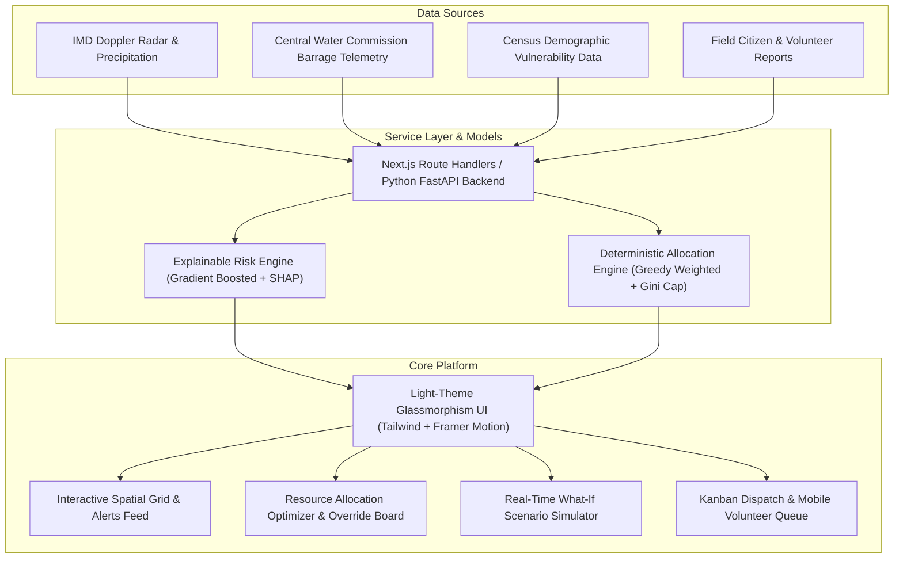

# ReliefIQ: AI-Powered Community Resource Allocation & Crisis Prediction System

> **Tagline:** *Predict crises. Allocate resources. Reach people first.*

ReliefIQ is an enterprise-grade disaster decision-support platform designed for **District Disaster Management Authorities (DDMA)**, **Humanitarian Relief Coordinators**, and **Frontline Volunteer Forces**. Calibrated with realistic telemetry for **Krishna District, Andhra Pradesh**, the platform identifies imminent climate hazards, quantifies resource shortfalls, and executes equitable AI-recommended relief allocations in one click.

---

## Architecture Overview



---

## Key Features & Capabilities

1. **Spatial Command Dashboard (`/app/dashboard`)**
   - Interactive spatial map of 16 Krishna District Mandals (Diviseema, Vijayawada, Machilipatnam, Avanigadda, etc.).
   - Live telemetry alerts sliding in real time with unread indicators and click-to-center.
   - Clickable zone drawer with demographic vulnerability breakdowns, top 3 predicted threats, and instant allocation triggers.
   - Live URL query synchronization (`?type=flood&horizon=24h&severity=critical`).

2. **Explainable Crisis Predictor (`/app/predict`)**
   - Transparent, non-black-box risk score (0–100) with confidence interval bands.
   - **"Why this prediction?"** panel: horizontal SHAP factor bars with plain-English meaning (rainfall rate, upstream barrage outflow, drainage integrity, housing kutcha percentage).

3. **Hero Feature: Resource Allocation Optimizer (`/app/allocate`)**
   - Real, deterministic optimization algorithm in `/lib/optimizer`.
   - Inventory sliders for food ration kits, potable water, medical packs, rescue boats, ambulances, and emergency tents.
   - Anti-hoarding fairness cap (15%–50%) ensuring remote hamlets are guaranteed relief.
   - Live Gini fairness score, people covered, and response time metrics.
   - Manual drag-and-drop overrides and stepper quantity adjustments.
   - **"Approve & Dispatch"** workflow with success confetti, dispatch task generation, and an 8-second undo toast.

4. **What-If Crisis Simulator (`/app/simulator`)**
   - Real-time environmental stress sliders: precipitation (0–450 mm), wind speed (10–180 km/h), temperature (24–50 °C), displaced evacuees, and dam discharge.
   - Side-by-side **"Do Nothing" vs "ReliefIQ Plan"** outcome deltas showing exact casualty exposure reductions.

5. **Fleet Dispatch & Volunteer Queue (`/app/dispatch`)**
   - District Officers & NGO Leads: 3-column Kanban board (*Pending Staging*, *In Transit*, *Delivered & Verified*).
   - Volunteers: Mobile-first responsive card view with 1-click **"Accept Task"** and **"Confirm Delivery"**.

6. **Citizen Incident Reports (`/app/reports`)**
   - Community submission form for flood inundation, water contamination, food shortages, and medical emergencies.
   - Submissions immediately enter the live spatial grid and alerts feed.

7. **Warehouse Inventory & Depots (`/app/inventory`)**
   - Stock ledger across the 3 strategic Krishna District depots (Vijayawada Central Logistics Hub, Machilipatnam Coastal Disaster Depot, Gudivada Rural Relief Depot).
   - Low-stock visual warnings and automated procurement restock requests.

8. **Executive Insights & Reporting (`/app/insights`)**
   - Model precision validation: Predicted vs Actual ground impact scores (R² = 0.94).
   - 1-click **Export Comprehensive CSV** containing all zones, populations, and risk scores.
   - **Print Official Briefing** with dedicated `@media print` clean formatting.

---

## Users and Role-Based Access Control

ReliefIQ features role-based routing and adaptive layouts. A **"Continue as demo user"** option is available on the landing page, login screen, and top navigation for immediate testing:

| Role | Access Rights | Primary Screens |
| :--- | :--- | :--- |
| **District Officer** | Full command, risk modeling, plan approval, dispatch overview, executive reports. | All screens (`/app/*`) |
| **NGO Coordinator** | Stock allocation, logistics fleet routing, warehouse restocking, dispatch tracking. | Allocation, Dispatch, Inventory, Insights |
| **Field Volunteer** | Mobile-first task execution, incident filing, delivery confirmation. | Task Queue (`/app/dispatch`), Reports |

---

## Tech Stack & Architecture

- **Framework:** Next.js 14 (App Router) + TypeScript (Strict mode, zero `any`)
- **Styling & Design System:** Tailwind CSS with custom pastel tokens (mint `#D7F5E9`, lavender `#E6E0FF`, sky `#DCEEFF`, peach `#FFE5D6`, butter `#FFF4CC`, rose `#FFDDE6`) and Plus Jakarta Sans.
- **State Management:** Zustand with LocalStorage persistence.
- **Data Layer:** TanStack React Query + Next.js Route Handlers (`/app/api`).
- **Validation:** Zod schemas as single source of truth in `/lib/types`.
- **Charts & Animation:** Recharts, Framer Motion, `canvas-confetti`.
- **Unit Testing:** Vitest + React Testing Library (5 optimizer unit tests, 1 full E2E workflow test).
- **Deployment:** Vercel ready with `vercel.json` security headers and clean caching.

---

## Getting Started

### Prerequisites
- Node.js `v18.17+` or `v20.x`
- npm `v9+` or `v10+`

### Installation
```bash
# Clone the repository
git clone https://github.com/your-username/reliefiq.git
cd reliefiq

# Install dependencies
npm install

# Run the development server
npm run dev
```

Visit [http://localhost:3000](http://localhost:3000) in your browser.

### Running Tests
```bash
# Run Vitest test suites (deterministic optimizer & E2E happy path)
npm test

# Run Next.js production build
npm run build
```

---

## Machine Learning Integration Guide (Python FastAPI)

ReliefIQ is built with a decoupled service layer. To replace the built-in Next.js mock engine with a real Python FastAPI ML service, set the environment variable:

```env
NEXT_PUBLIC_API_BASE_URL=https://api.your-fastapi-service.com
```

### 1. `/predict` Endpoint Contract

**Request (`POST /api/v1/predict`):**
```json
{
  "zoneId": "zone-4",
  "crisisType": "flood",
  "horizon": "24h",
  "meteorologicalTelemetry": {
    "rainfallMm24h": 240.0,
    "riverDischargeCusecs": 780000.0,
    "windSpeedKmh": 45.0,
    "temperatureC": 32.5
  },
  "topography": {
    "elevationMeters": 4.2,
    "drainageCapacityPct": 45.0,
    "embankmentStressScore": 88.0
  }
}
```

**Response (`200 OK`):**
```json
{
  "riskScore": 91,
  "severity": "critical",
  "confidence": 94,
  "factors": [
    {
      "id": "f-rain",
      "name": "Monsoon Precipitation Intensity",
      "contributionPct": 85,
      "direction": "increases_risk",
      "impactValue": "240 mm / 24h",
      "explanation": "Heavy continuous rainfall exceeds natural run-off drainage capacity."
    },
    {
      "id": "f-river",
      "name": "Prakasam Barrage Discharge",
      "contributionPct": 90,
      "direction": "increases_risk",
      "impactValue": "7.8 Lakh Cusecs",
      "explanation": "Barrage discharge exceeds first warning embankment safety limits."
    }
  ],
  "forecastTimeline": [
    { "timeLabel": "T - 6h", "score": 79, "lowerBound": 73, "upperBound": 85 },
    { "timeLabel": "Present", "score": 91, "lowerBound": 83, "upperBound": 99 },
    { "timeLabel": "T + 12h", "score": 95, "lowerBound": 89, "upperBound": 100 }
  ]
}
```

### 2. `/allocate` Endpoint Contract

**Request (`POST /api/v1/allocate`):**
```json
{
  "crisisType": "flood",
  "fairnessCapPct": 35.0,
  "availableInventory": {
    "foodKits": 26500,
    "potableWaterLiters": 74500,
    "medicalKits": 7350,
    "rescueBoats": 76,
    "ambulances": 28,
    "shelters": 1350
  }
}
```

**Response (`200 OK`):**
```json
{
  "id": "plan-fastapi-91823",
  "assignments": [
    {
      "id": "asg-zone-4-boats",
      "zoneId": "zone-4",
      "zoneName": "Diviseema (Nagayalanka Belt)",
      "resourceType": "rescue_boats",
      "quantity": 18,
      "unit": "boats",
      "warehouseId": "wh-2",
      "warehouseName": "Machilipatnam Coastal Disaster Depot",
      "etaMinutes": 48,
      "justification": "Confluence of tidal surge and river outflow cutting island habitations."
    }
  ],
  "peopleCovered": 142800,
  "fairnessScore": 88,
  "unmetNeedPct": 11.6,
  "estimatedResponseTimeHours": 1.8
}
```

---

## Design System & Tokens

ReliefIQ strictly follows a **Light Theme Only** design aesthetic with soft pastel gradient backgrounds:

- **Mint (`#D7F5E9`):** Safe, low risk, positive allocations.
- **Butter (`#FFF4CC`):** Medium risk, warning state.
- **Peach (`#FFE5D6`):** High risk, pre-evacuation alert.
- **Rose (`#FFDDE6`):** Critical danger, active evacuation pulse.
- **Primary Indigo (`#4F46E5`):** High-confidence actions, buttons, and active tabs.
- **Glassmorphism:** `backdrop-blur-md`, white at 70% opacity, 20px radius cards, 1px soft border.
- **Accessibility:** Color is never used alone; icons (`ShieldCheck`, `AlertCircle`, `AlertTriangle`, `Flame`) accompany all risk levels.

---

## End-to-End Demo Flow

To demonstrate the full capability of ReliefIQ:

1. **Landing Page (`/`):** View the live Krishna District interactive map preview and stats strip.
2. **Demo Sign In (`/auth`):** Click **"Continue as District Officer"** to enter with executive clearance.
3. **Command Dashboard (`/app/dashboard`):**
   - Click on the critical hotspot **Diviseema** on the map to open the drawer.
   - Review population at risk (62,400) and top threats.
   - Click **"Allocate Resources for Diviseema Now"**.
4. **AI Resource Allocation (`/app/allocate`):**
   - Tweak the anti-hoarding fairness slider to 35%.
   - Click **"Re-Run AI Matching"** to observe deterministic need scoring.
   - Manually increase boat allocation using the stepper or drag-and-drop.
   - Click **"Approve & Dispatch Convoys"** to trigger celebration confetti and mobilize the convoys.
5. **Dispatch Board (`/app/dispatch`):**
   - View newly mobilized convoys moving across NH-216 into Diviseema.
   - Click **"Mark Delivered"** on an active task to verify delivery.
6. **Executive Insights (`/app/insights`):**
   - Check updated fulfillment metrics and click **"Export CSV"** to download the official district dataset.

---

## Known Limitations & Future Roadmap

- **Map Libre GL Offline Tiles:** Currently uses vector svg contour fallback with coordinate projection for offline and restricted environments; satellite vector tile caching can be added for deeper zoom levels.
- **Bi-Directional Telemetry:** Future releases will connect directly to LoRaWAN water-depth gauge sensors deployed at Puligadda Aqueduct.
- **Multi-District Federations:** Extend model scaling from Krishna District to the entire Godavari and Rayalaseema river basins.

---

## License

Developed under the MIT License for Community Crisis Resilience and Public Safety.
